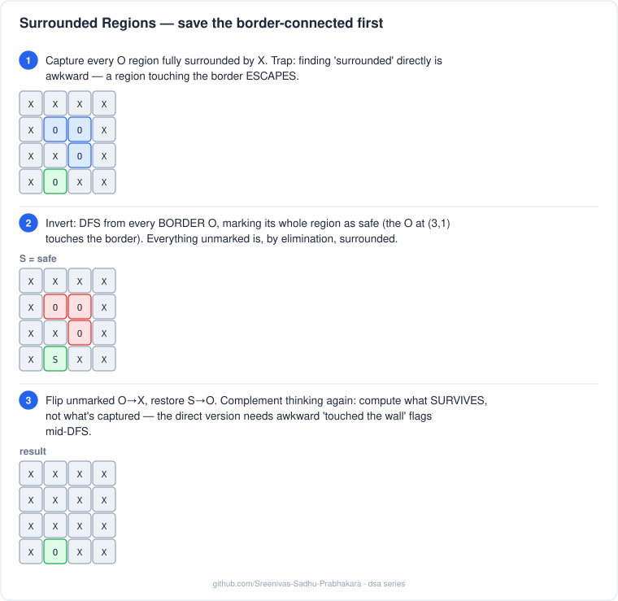

# Surrounded Regions

> NeetCode 150 · Graphs — invert the question: don't find surrounded regions, find the safe ones (border-connected), then flip everything unsaved. Go, stdlib only, tested.

## Problem

On an X/O board, capture (flip to X) every O region completely enclosed by X. Regions touching the border escape.

## Approach

"Surrounded" is awkward to detect directly — a DFS must prove *no* path reaches the border. Its complement is trivial: a region survives iff it touches the border. So flood-fill from every border O, relabeling those regions with a temporary marker ('S'); afterwards, one sweep flips remaining Os (provably interior) to X and restores the markers to O. The three-state relabeling inside the board itself removes the need for any visited structure. This complement trick — compute the easy inverse set and subtract — is the same shape as Pacific-Atlantic's reverse flow (dsa-226), and together they're the pattern's two canonical drills.

**Complexity:** O(R·C) time; recursion up to region size.

## Visual walkthrough

Read the picture top to bottom — each numbered frame is one moment of the algorithm
running on this repo's test example.

## Run

    go test ./...   # verify
    go run .        # demo

---

Part of a 275-repo DSA series in Go — Striver's SDE Sheet (dsa-001–191) plus the NeetCode 150 / Blind 75 additions (dsa-192–275), stdlib only, every solution tested. Browse: [`dsa-*` repos](https://github.com/Sreenivas-Sadhu-Prabhakara?tab=repositories&q=dsa-&type=source).
